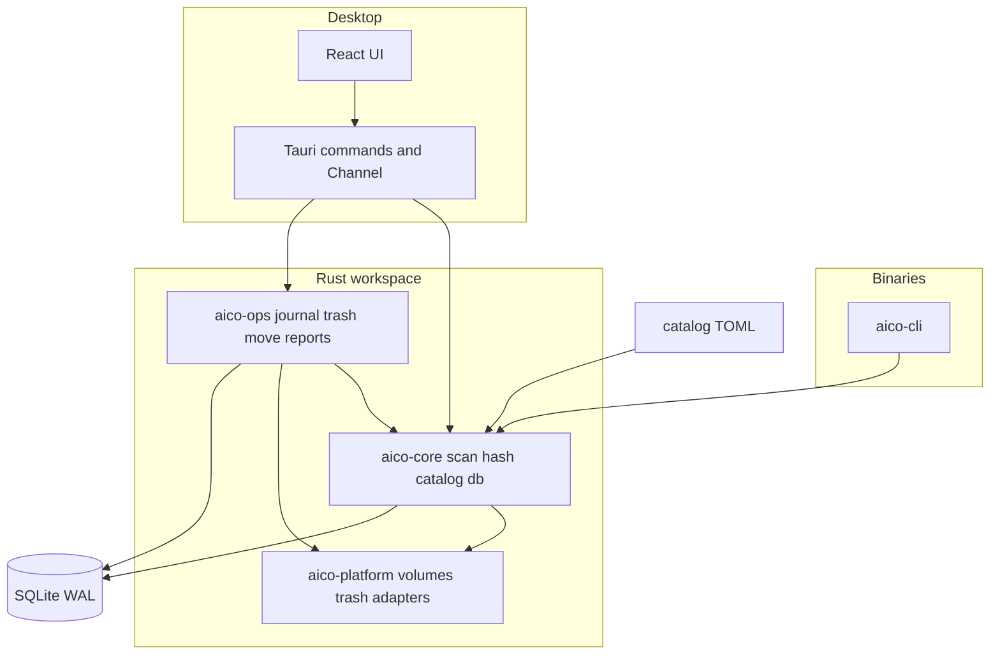
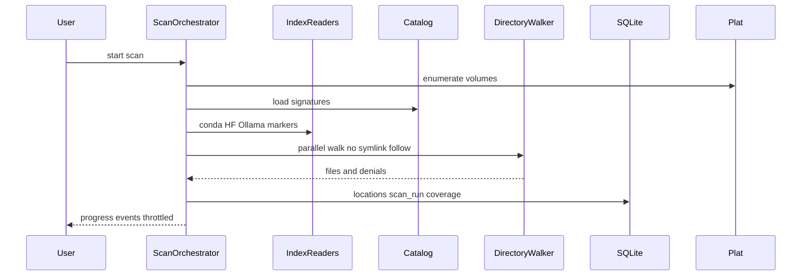

# AIcoSystem v0.1

* **Author:** mfontecchio
* **Status:** Proposed (see docs/designs/aicosystem-v0.1-design.md)
* **Date:** 2026-03-24

---

## Overview

AIcoSystem is a local-first desktop application that helps one power user understand and reclaim disk space consumed by AI software on a single dual-boot machine. Version 0.1 focuses on discovery, honest size reporting, duplicate detection, reversible cleanup, and directory moves that keep applications working through a symlink at the old path. The product does not replace Ollama, ComfyUI, or container engines; it inventories what is already installed and performs only user-approved file operations on the operating system that is currently booted.

The implementation uses a Rust core shared by a CLI and a Tauri 2 desktop shell, with React for the UI and SQLite for local inventory and operation history. Integrations are declared as catalog data (TOML), not as a plugin runtime.

---

## The Problem

The author’s storage is full. Over time they installed AI runtimes, model files, Python and Conda environments, package caches, and container-related data for separate projects. Tools store content in default locations, custom paths, and on a second operating system’s partition. There is no single view that answers:

- How much space AI-related data uses in total.
- Which folders belong to which tool.
- Which files are byte-identical duplicates.
- What can be removed or moved without breaking a still-used path.

Existing duplicate finders and model-folder managers address part of this but do not combine an AI-specific location catalog, dual-boot read-only visibility, safe move-with-link semantics, and an operation journal aimed at a full drive.

---

## Goals

Success for v0.1 means the author can routinely:

1. **See inventory** — Run a scan on Fedora that lists catalog-attributed and unknown AI-related locations on native volumes and, when mounted, the Windows NTFS partition (read-only observation only).
2. **Trust the numbers** — For each location, view apparent size, allocated size, and exclusively reclaimable size, with scan coverage explaining skipped or inaccessible paths.
3. **Find duplicates** — Group files by staged content hashing (with cache), including cross-partition visibility where read-only scan allows, without treating hardlinked paths as independent reclaimable space.
4. **Clean up safely** — Preview cleanup with separate figures for bytes sent to trash, bytes freed only after trash purge, and regenerable cache purge; record operations in a journal; undo when OS and journal preconditions still hold.
5. **Move directories** — Relocate a whole directory (for example a model tree or cache root) to another native writable volume using copy, verify, `.aico-old` rename, symlink at the original path, and a written location report; no editing of third-party config files.
6. **Use CLI or GUI** — Obtain the same core scan results from `aico scan --json` and from the desktop inventory views.

Release acceptance is defined in [docs/product/prd-v1.md](docs/product/prd-v1.md) (including the ~90% catalog-root byte coverage check against `dua` on the author machine).

---

## Non-Goals

The following are explicitly out of scope for v0.1:

- Rewriting application configuration files or registry keys.
- Installing, updating, or uninstalling third-party AI applications.
- GPU detection, model compatibility scoring, or running inference.
- Stopping, removing, or pruning containers except reporting size and suggesting external commands.
- A plugin marketplace or unsigned third-party integration SDK.
- Multi-machine fleet management, cloud accounts, or outbound telemetry.
- A full asset relationship graph that automatically authorizes deletion.
- Primary development or release testing on Ubuntu (Fedora is primary; Windows builds compile in CI).
- Windows-native scanning, junction-based moves, and Recycle Bin preflight as shipped features (planned for M6 after v0.1).
- Flatpak distribution (sandbox blocks required host paths).
- Permanent delete as the default cleanup path (regenerable caches are the exception with explicit labeling).

---

## Open Questions

- **Volume UUID on Linux:** Use `blkid`, `/dev/disk/by-uuid`, or a stable synthetic id when binding mounts lack a UUID? Choice affects hash cache keys and foreign-volume identity.
- **NTFS driver behavior:** On the author’s Fedora setup, classify skip reasons for both `ntfs3` and `fuseblk` (ntfs-3g) and document Fast Startup / dirty-volume detection limits.
- **Reclaimable size on Btrfs with Snapper:** v0.1 warns on snapshots; how much extent sharing detection is required versus a clear “may not free space” disclaimer?
- **UI theme:** Dark-first with optional light theme was assumed at brainstorm; confirm before polishing M3 screens.
- **Regenerable purge commands:** Invoke tool CLIs (`pip cache purge`, `huggingface-cli delete-cache`, etc.) versus file-level delete only in v0.1.

---

## Critical User Journeys (CUJs)

### CUJ 1: First scan on a full Fedora system

* **Given:** AIcoSystem installed; catalog present under `catalog/`; user has not run a scan before; Windows NTFS partition may or may not be mounted read-only.
* **When:** User runs `aico scan --json` or starts a scan from the desktop app.
* **Then:** Output includes volumes with `VolumeClass`, catalog-matched locations with “used by” labels, coverage summary (skipped foreign/hidden roots), and no filesystem mutations; if NTFS is mounted read-only, Windows-profile paths appear with write actions disabled in the UI.

### CUJ 2: Review duplicates before any delete

* **Given:** A completed scan; hash pass finished or in progress with visible state.
* **When:** User opens Duplicates and selects a group with two members on the same native volume.
* **Then:** UI shows confirmed duplicate status, reclaimable bytes if one copy is removed, and blocks one-click delete if a catalog rule marks a path as the only attributed copy unless the user confirms an override.

### CUJ 3: Move a model directory to another drive

* **Given:** Source directory on a native writable volume; destination has sufficient free space; no denylisted path (containers, root-owned service store); journal empty or reconciled.
* **When:** User confirms move preview (paths, temporary space need, symlink plan).
* **Then:** Journal steps run in order; symlink at old path resolves; location report written under app data and mirrored on destination; `.aico-old` remains until user trashes it.

### CUJ 4: Recover from interrupted move

* **Given:** A previous move stopped mid-`Copying` or mid-`SourceRenamed`.
* **When:** User starts AIcoSystem again.
* **Then:** Reconciler detects incomplete operation and offers resume or rollback before any new mutation; source data is not silently deleted.

---

## Technical Plan (Architecture)

### Principles

1. **Read-only discovery** — Scanning code paths use `FsRead` only (`aico-core` + `aico-platform`). No scan-time writes.
2. **Gated mutation** — Trash, purge, and move run only in `aico-ops`, after `VolumeClass` and denylist checks (see ADRs in `docs/decisions/`).
3. **Data-before-code integrations** — New tools are added by TOML under `catalog/`, loaded by `aico-core::catalog`.
4. **One DB per OS install** — SQLite at `~/.local/share/aicosystem/` on Linux; locations keyed by `(volume_stable_id, relative_path)` (stable id mechanism: open question).
5. **CLI parity** — GUI calls the same Rust APIs as `aico-cli`, not a parallel implementation.

### Component diagram

### Scan pipeline

**Index phase (before deep walk):** Read conda `environments.txt`, Hugging Face `hub` layout markers, Ollama manifest tree, `pyvenv.cfg` hits, optional `podman system df` for size-only container row. **Walk phase:** `ignore::WalkBuilder` with explicit roots, container overlay paths on the denylist, no following symlinks. **Persist:** `locations`, `catalog_matches`, `scan_runs` with JSON coverage blob.

### Hash and duplicate pipeline

Group files by size → partial hash first and last 1 MiB → BLAKE3 full hash on survivors → upsert `file_hashes` keyed by file identity and mtime → build duplicate groups. Ollama/Hugging Face blob filenames may supply a **claimed** SHA-256; delete authorization requires verification pass.

### Operation journal (cleanup and move)

States follow ADR 0007: `Planned` through `Committed`, with rollback paths. Each step row is committed to SQLite before the matching filesystem action. Startup reconciler runs before the UI enables destructive buttons.

Move sequence (Linux v0.1, directories only): copy → hash/size verify → rename source to `.aico-old` → symlink at original path → verify through old path → write location report JSON + Markdown.

### SQLite schema (v0.1)

| Table | Role |
| ----- | ---- |
| `volumes` | stable id, mount point, fs type, class |
| `scan_runs` | timestamps, status, coverage JSON |
| `locations` | volume id + relative path, sizes, used-by, confidence |
| `catalog_matches` | location id ↔ signature id, evidence |
| `file_hashes` | cache and duplicate membership |
| `operations` | user-visible operation header |
| `operation_steps` | journal state machine |

No relationship graph tables in v0.1.

### Desktop IPC (planned)

Tauri commands (typed via `tauri-specta`): `list_volumes`, `start_scan`, `cancel_scan`, `list_locations` (paginated filters), `list_duplicates`, `preview_cleanup`, `execute_cleanup`, `preview_move`, `execute_move`, `list_operations`, `undo_operation`, `get_coverage`.

Progress: `Channel` events `scan_progress { phase, bytes_done, files_done }` capped ~10 Hz. Errors: `AppError` enum with stable string codes serialized to the UI.

### Platform scope

| Capability | Fedora (v0.1) | Windows (v0.1) |
| ---------- | ------------- | -------------- |
| Volume list + class | mountinfo + ntfs detect | stub / compile only |
| Scan native FS | full | M6 |
| Scan foreign NTFS | read-only | n/a |
| Trash / move | full journal | M6 + quota preflight |
| CI | Fedora container tests | build + selective tests |

### Security and privacy

No network for core features. Capabilities file allows only registered commands (no broad `fs` plugin writes from frontend). Discovery never executes arbitrary shell from catalog entries in v0.1.

### Non-Functional Requirements (critical)

| ID | Requirement | Approach |
| -- | ----------- | -------- |
| NFR-01 | Scan is read-only | `FsRead` boundary |
| NFR-03 | Safe DB migrate | forward-only migrations; refuse newer schema |
| NFR-05 | UI responsive on large inventories | pagination + virtualized tables |
| NFR-06 | Fedora packaging | RPM/AppImage docs; not Flatpak |

---

## Alternatives Considered

### Alternative A: Ship full `.research/idea.md` platform (15 crates, graph, GPU, plugins)

* **Pros:** Single long-term vision; rich enterprise feature set.
* **Cons:** Roughly 9–15 months at 15–20 h/week for one developer; ship date far past the author’s immediate need (full disk).
* **Reason for rejection:** Rejected by author after Goldfish review: prove scan + safe cleanup first.

### Alternative B: Rely on Stability Matrix + czkawka only

* **Pros:** Less code; known tools for shared models and duplicates.
* **Cons:** AGPL on Stability Matrix; no unified AI catalog (Ollama, HF, conda); no dual-boot read-only inventory; no move-with-link journal.
* **Reason for rejection:** Rejected by author: does not cover the whole problem statement.

### Alternative C: Config rewriting on move

* **Pros:** Apps that resolve real paths might work without symlinks; matches some enterprise asset managers.
* **Cons:** Highest breakage risk; per-app config formats; must run on the OS that owns the config; contradicts v0.1 safety stance.
* **Reason for rejection:** Rejected by author: excluded in favor of symlink/junction plus location report (ADR 0010).

### Alternative D: Single shared SQLite on a neutral NTFS data partition

* **Pros:** One inventory across boots.
* **Cons:** Stale rows after moves on one OS; lock and migration races; writes to foreign partition unsafe from Fedora.
* **Reason for rejection:** Rejected by author: one DB per OS install with export/import deferred to M6.

### Alternative E: SQLx async SQLite

* **Pros:** Async queries integrate with some Rust web patterns.
* **Cons:** Extra CI setup (`DATABASE_URL` / offline data); async overhead for local single-writer store.
* **Reason for rejection:** Rejected by author: `rusqlite` bundled + dedicated writer thread (ADR 0001).

### Alternative F: Immediate permanent delete for cleanup

* **Pros:** Frees disk space immediately on a full volume.
* **Cons:** Breaks “reversible by default”; user fear on large model files.
* **Reason for rejection:** Rejected by author: trash-first with explicit purge; regenerable caches labeled separately (ADR 0005).

### Alternative G: Windows-first dual-boot scanner

* **Pros:** Matches users who live primarily in Windows.
* **Cons:** Windows cannot read Fedora Btrfs; cross-partition value mostly Linux → NTFS anyway.
* **Reason for rejection:** Rejected by author: Fedora-first development and read-only NTFS observation (ADR 0002).

---

## Detailed Implementation Plan

Work proceeds in milestone order **M0 → M1 → M2 → M3 → M4 → M5** (M6 post-release). Each milestone should leave CI green on the crates it touches. GitHub issues live in `docs/backlog/issues.yaml` (already mirrored to GitHub).

### M0 — Foundation (current scaffold → complete)

#### `Cargo.toml` (Modify)

* **Scope:** Workspace manifest.
* **Changes:** Pin workspace dependency versions; add missing crates (`aico-fixtures` when created); document MSRV in comment pointing to `rust-toolchain.toml`.

#### `rust-toolchain.toml` (Modify)

* **Scope:** Toolchain pin.
* **Changes:** Align channel with CI and author machine after first successful local build.

#### `crates/aico-core/` (Modify)

* **Scope:** Domain, catalog, DB, scan modules.
* **Changes:** Split `lib.rs` into `catalog`, `db/migrate`, `scan/orchestrator` stubs; implement `CatalogSignature` types matching TOML schema; add `open_db()` with migration guard.

#### `crates/aico-platform/` (Modify)

* **Scope:** Linux volume enumeration.
* **Changes:** Replace placeholder `linux:{mount_point}` uuid with stable id spike (pending open question); parse `/proc/self/mountinfo`; classify `VolumeClass`; expose `FsRead` trait.

#### `crates/aico-ops/` (Modify)

* **Scope:** Mutation boundary stubs.
* **Changes:** Define `FsWrite` trait and `assert_writable()`; journal module empty impl returning `NotImplemented` until M4.

#### `crates/aico-cli/` (Modify)

* **Scope:** CLI entry.
* **Changes:** Flesh out `scan` subcommand to call orchestrator; global `--db` path flag defaulting to XDG data dir.

#### `catalog/*.toml` (Modify)

* **Scope:** Integration data.
* **Changes:** Expand paths for author machine (Flatpak hints, torch hub, `~/.cache/torch`); add `windows_paths` optional fields for future M6; document schema in `catalog/schema.toml`.

#### `scripts/catalog-spike.sh` (Modify)

* **Scope:** Validation script.
* **Changes:** Parse all `linux_paths` from TOML via simple grep or small Rust helper; output JSON comparable to `dua`.

#### `migrations/001_init.sql` (Create)

* **Scope:** SQLite schema v1.
* **Changes:** Seven tables as in Technical Plan; `user_version` protocol documented in `aico-core`.

#### `apps/desktop/` (Modify)

* **Scope:** Tauri shell only in M0.
* **Changes:** Add app icons under `src-tauri/icons/` so bundle config validates; wire `WEBKIT_DISABLE_DMABUF_RENDERER` guard in `main` when NVIDIA+Wayland detected (platform module callback).

#### `.github/workflows/ci.yml` (Modify)

* **Scope:** CI.
* **Changes:** Fail Tauri job on compile error once icons exist; add `cargo test` for migration tests.

#### `docs/decisions/*.md` (Modify)

* **Scope:** ADRs.
* **Changes:** Update ADR 0004 when volume id mechanism is chosen.

### M1 — Read-only scan CLI

#### `crates/aico-core/src/scan/walker.rs` (Create)

* **Scope:** Parallel walk.
* **Changes:** `ignore::WalkBuilder`; denylist for container roots; record `EACCES` paths.

#### `crates/aico-core/src/scan/index.rs` (Create)

* **Scope:** Index-first discovery.
* **Changes:** Readers for conda, HF hub layout, Ollama manifests, venv markers.

#### `crates/aico-core/src/scan/sizing.rs` (Create)

* **Scope:** Metrics.
* **Changes:** Apparent, allocated (`st_blocks`), reclaimable via inode dedup (`same-file`).

#### `crates/aico-core/src/scan/orchestrator.rs` (Create)

* **Scope:** Scan coordinator.
* **Changes:** Phases, cancellation, persist `scan_runs` and `locations`.

#### `crates/aico-core/src/format/sniff.rs` (Create)

* **Scope:** Model headers.
* **Changes:** GGUF and SafeTensors limited parse with size caps (no large array loads).

#### `docs/api/scan-json-schema.md` (Create)

* **Scope:** CLI contract.
* **Changes:** Document `aico scan --json` output for UI and tests.

#### `crates/aico-fixtures/` (Create)

* **Scope:** Test trees.
* **Changes:** Build temp dirs: unreadable subdir, hardlink pair, fake HF symlink layout.

#### `crates/aico-cli/src/main.rs` (Modify)

* **Scope:** CLI.
* **Changes:** Implement scan output per schema.

### M2 — Duplicates and foreign NTFS

#### `crates/aico-core/src/hash/staged.rs` (Create)

* **Scope:** Hash pipeline ADR 0008.
* **Changes:** Size bucket, partial 1 MiB ends, BLAKE3, cache integration.

#### `crates/aico-core/src/hash/claimed.rs` (Create)

* **Scope:** Ollama/HF filename digests.
* **Changes:** Verify-before-delete helper.

#### `crates/aico-core/src/scan/foreign_ntfs.rs` (Create)

* **Scope:** Foreign volume scan rules.
* **Changes:** Read-only enforcement flag on locations; skip reason enums.

#### `crates/aico-platform/src/linux/ntfs.rs` (Create)

* **Scope:** NTFS skip detection.
* **Changes:** Best-effort dirty/hibernate signals from mount flags and optional `ntfsfix -n` avoidance (read-only checks only).

#### `crates/aico-platform/src/linux/containers.rs` (Create)

* **Scope:** Podman/Docker size.
* **Changes:** Optional socket/API probe; single summary location row.

#### `crates/aico-cli/src/main.rs` (Modify)

* **Scope:** CLI.
* **Changes:** `scan --duplicates` or include duplicate section in JSON.

### M3 — Desktop viewer

#### `apps/desktop/package.json` (Modify)

* **Scope:** Frontend deps.
* **Changes:** Add `@tanstack/react-table`, `@tanstack/react-virtual`, `@tauri-apps/api` as needed.

#### `apps/desktop/src/features/inventory/` (Create)

* **Scope:** UI.
* **Changes:** Virtualized table for locations; size columns; filter by class and used-by.

#### `apps/desktop/src/features/duplicates/` (Create)

* **Scope:** UI.
* **Changes:** Group list, hash progress states.

#### `apps/desktop/src/features/coverage/` (Create)

* **Scope:** UI.
* **Changes:** Skipped volume reasons.

#### `apps/desktop/src-tauri/src/commands.rs` (Create)

* **Scope:** IPC.
* **Changes:** Commands listed in Technical Plan; integrate `tauri-specta`.

#### `apps/desktop/src-tauri/src/lib.rs` (Modify)

* **Scope:** Wiring.
* **Changes:** Register commands and progress Channel.

#### `apps/desktop/src-tauri/capabilities/default.json` (Modify)

* **Scope:** Security.
* **Changes:** Least privilege; no raw filesystem scope for webview.

### M4 — Reversible cleanup

#### `crates/aico-ops/src/journal.rs` (Create)

* **Scope:** State machine ADR 0007.
* **Changes:** Write-ahead steps, reconciler on startup.

#### `crates/aico-ops/src/trash/linux.rs` (Create)

* **Scope:** Freedesktop trash.
* **Changes:** `trash` crate wrapper + same-device preflight.

#### `crates/aico-ops/src/purge/regenerable.rs` (Create)

* **Scope:** Cache class.
* **Changes:** File-level delete or documented external CLI invocation per user confirmation.

#### `crates/aico-ops/src/preview.rs` (Create)

* **Scope:** Shared preview model.
* **Changes:** Seven preview fields for UI (paths, three byte metrics, references, undo limits).

#### `apps/desktop/src/features/cleanup/` (Create)

* **Scope:** UI.
* **Changes:** Preview modal, confirm, Activity list.

#### `crates/aico-ops/tests/crash_inject.rs` (Create)

* **Scope:** Safety tests.
* **Changes:** Fake `FsWrite` failures at defined journal states.

### M5 — Move with link and release

#### `crates/aico-ops/src/move_dir.rs` (Create)

* **Scope:** Linux directory move ADR 0006.
* **Changes:** Copy, verify, `.aico-old`, symlink, report generation.

#### `crates/aico-ops/src/report.rs` (Create)

* **Scope:** Location report.
* **Changes:** JSON + Markdown to app dir and destination mirror; optional env var hints from catalog.

#### `crates/aico-ops/src/preflight.rs` (Create)

* **Scope:** Denylist and in-use checks.
* **Changes:** `fuser` best-effort, Flatpak path warning.

#### `crates/aico-ops/src/link_health.rs` (Create)

* **Scope:** Startup checks.
* **Changes:** Detect dangling symlinks from prior moves.

#### `docs/packaging/fedora.md` (Create)

* **Scope:** Release.
* **Changes:** RPM/AppImage build notes, WebKit deps, NVIDIA env vars.

#### `apps/desktop/src/features/activity/` (Create)

* **Scope:** UI.
* **Changes:** Undo when journal + OS allow.

### M6 (post v0.1) — Windows native

#### `crates/aico-platform/src/windows/` (Create)

* **Scope:** Volumes, junction moves, Recycle Bin quota.

#### `crates/aico-cli/src/import.rs` (Create)

* **Scope:** Import scan JSON from Fedora export.

### Files intentionally not changed in v0.1

* `.research/idea.md` — historical input only.
* `scripts/bootstrap-board.sh` — update only if issue template changes.
* `concepts_brief.md` / `docs/designs/aicosystem-v01.md` — frozen RFC unless scope pivot.

### Verification Plan

* **Build:** `cargo build --workspace`; `npm run build` in `apps/desktop/`.
* **Unit tests:** `cargo test -p aico-core -p aico-ops`; migration tests on temp DB.
* **Integration:** Fedora container job runs fixture tests; loop-mounted ext4/btrfs optional later.
* **Manual:** Author runs catalog spike vs `dua`; dual-boot NTFS mounted read-only scan; one real directory move with Ollama or HF path.
* **Release gates:** PRD acceptance criteria 1–7 in `docs/product/prd-v1.md`.

---

### Additional Resources

* [docs/product/prd-v1.md](docs/product/prd-v1.md)
* [docs/product/glossary.md](docs/product/glossary.md)
* [docs/decisions/](docs/decisions/)
* [docs/backlog/backlog.md](docs/backlog/backlog.md)
* [concepts_brief.md](concepts_brief.md)

### Future Improvements

* Asset graph with provenance; cross-OS action queue; hardlink/reflink dedup; offline Windows registry hive reads; MFT fast path; GPU compatibility module (see [docs/product/vision.md](docs/product/vision.md)).

---

*Drafted with EGM*
