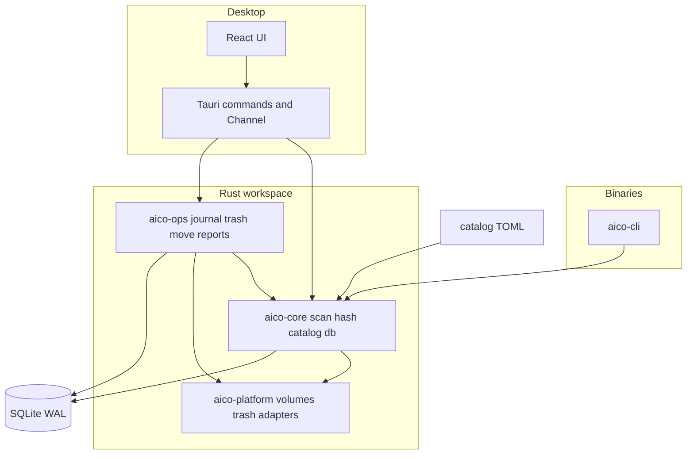
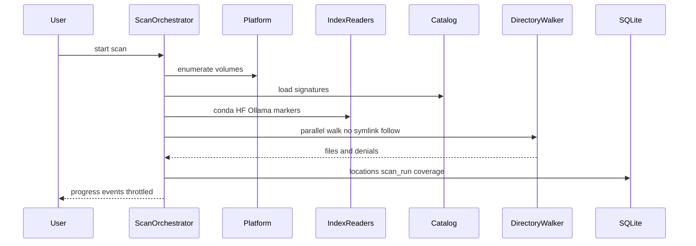

# AIcoSystem v0.1

* **Author:** mfontecchio
* **Status:** Proposed
* **Date:** 2026-03-24

---

## Overview

AIcoSystem is a local-first desktop application that helps one power user understand and reclaim disk space consumed by AI software on a single dual-boot machine. Version 0.1 focuses on discovery, size reporting with coverage transparency, duplicate detection, reversible cleanup, and directory moves that keep applications working through a symlink at the old path. The product does not replace Ollama, ComfyUI, or container engines; it inventories what is already installed and performs only user-approved file operations on the operating system that is currently booted.

The implementation uses a Rust core shared by a CLI and a Tauri 2 desktop shell, with React for the UI and SQLite for local inventory and operation history. Integrations are declared as catalog data (TOML), not as a plugin runtime.

---

## The Problem

The author’s storage is full. Over time they installed AI runtimes, model files, Python and Conda environments, package caches, and container-related data for separate projects. Tools store content in default locations, custom paths, and on a second operating system’s partition. There is no single view that answers:

- How much space AI-related data uses in total.
- Which folders belong to which tool.
- Which files are byte-identical duplicates.
- What can be removed or moved without breaking a still-used path.

Existing duplicate finders and model-folder managers address part of this but do not combine an AI-specific location catalog, dual-boot read-only visibility, safe move-with-link semantics, and an operation journal aimed at a full drive.

---

## Goals

Success for v0.1 means the author can routinely:

1. **See inventory** — Run a scan on Fedora that lists catalog-attributed and unknown AI-related locations on native volumes and, when mounted, the Windows NTFS partition (read-only observation only).
2. **Trust the numbers** — For each location, view apparent size, allocated size, and exclusively reclaimable size, with scan coverage explaining skipped or inaccessible paths.
3. **Find duplicates** — Group files by staged content hashing (with cache), including cross-partition visibility where read-only scan allows, without treating hardlinked paths as independent reclaimable space.
4. **Clean up safely** — Preview cleanup with separate figures for bytes sent to trash, bytes freed only after trash purge, and regenerable cache purge; record operations in a journal; undo when OS and journal preconditions still hold.
5. **Move directories** — Relocate a whole directory (for example a model tree or cache root) to another native writable volume using copy, verify, `.aico-old` rename, symlink at the original path, and a written location report; no editing of third-party config files.
6. **Use CLI or GUI** — Obtain the same core scan results from `aico scan --json` and from the desktop inventory views.

Release acceptance is defined in [docs/product/prd-v1.md](docs/product/prd-v1.md) (including the ~90% catalog-root byte coverage check against `dua` on the author machine).

---

## Non-Goals

The following are explicitly out of scope for v0.1:

- Rewriting application configuration files or registry keys.
- Installing, updating, or uninstalling third-party AI applications.
- GPU detection, model compatibility scoring, or running inference.
- Stopping, removing, or pruning containers except reporting size and suggesting external commands.
- A plugin marketplace or unsigned third-party integration SDK.
- Multi-machine fleet management, cloud accounts, or outbound telemetry.
- A full asset relationship graph that automatically authorizes deletion.
- Primary development or release testing on Ubuntu (Fedora is primary; Windows builds compile in CI).
- Windows-native scanning, junction-based moves, and Recycle Bin preflight as shipped features (planned for M6 after v0.1).
- Flatpak distribution (sandbox blocks required host paths).
- Permanent delete as the default cleanup path (regenerable caches are the exception with explicit labeling).

---

## Open Questions

- **UI theme:** Dark-first with optional light theme was assumed at brainstorm; confirm before polishing M3 screens.

**Closed in this revision (see Technical Plan / ADR 0004):** Linux volume `stable_id` via UUID → `dev:{major}:{minor}` → `mp:{hash}`; NTFS skip reason enum; Btrfs reclaimable uses allocated bytes with snapshot disclaimer; regenerable cleanup uses file-level delete in v0.1 (optional CLI purge deferred).

---

## Critical User Journeys (CUJs)

### CUJ 1: First scan on a full Fedora system

* **Given:** AIcoSystem installed; catalog present under `catalog/`; user has not run a scan before; Windows NTFS partition may or may not be mounted read-only.
* **When:** User runs `aico scan --json` or starts a scan from the desktop app.
* **Then:** Output includes volumes with `VolumeClass`, catalog-matched locations with “used by” labels, coverage summary (skipped foreign/hidden roots), and no filesystem mutations; if NTFS is mounted read-only, Windows-profile paths appear with write actions disabled in the UI.

### CUJ 2: Review duplicates before any delete

* **Given:** A completed scan; hash pass finished or in progress with visible state.
* **When:** User opens Duplicates and selects a group with two members on the same native volume.
* **Then:** UI shows confirmed duplicate status, reclaimable bytes if one copy is removed, and blocks one-click delete if a catalog rule marks a path as the only attributed copy unless the user confirms an override.

### CUJ 3: Move a model directory to another drive

* **Given:** Source directory on a native writable volume; destination has sufficient free space; no denylisted path (containers, root-owned service store); journal empty or reconciled.
* **When:** User confirms move preview (paths, temporary space need, symlink plan).
* **Then:** Journal steps run in order; symlink at old path resolves; location report written under app data and mirrored on destination; `.aico-old` remains until user trashes it.

### CUJ 4: Recover from interrupted move

* **Given:** A previous move stopped mid-`Copying` or mid-`SourceRenamed`.
* **When:** User starts AIcoSystem again.
* **Then:** `aico-ops` reconciler detects incomplete operation and offers resume or rollback before any new mutation; source data is not silently deleted.

### CUJ 5: Cleanup with three byte figures

* **Given:** User selected reclaimable trash candidates on a native writable volume.
* **When:** User opens cleanup preview.
* **Then:** Preview shows trash-now bytes, bytes freed only after trash purge, and separate regenerable purge totals with distinct labels; confirm is disabled until all three are acknowledged when non-zero.

### CUJ 6: Foreign NTFS inventory, no writes

* **Given:** Windows NTFS partition mounted read-only under `/run/media/...`.
* **When:** Scan completes including foreign paths.
* **Then:** Locations show `writable_actions: false`; cleanup and move actions are hidden or blocked; coverage lists driver-specific skip limits when Fast Startup or dirty volume is detected.

### CUJ 7: Undo trash when journal allows

* **Given:** A completed trash operation with steps in `Committed` or `Undoable`.
* **When:** User chooses undo and trash volume still mounts.
* **Then:** Journal runs reverse steps; files restore from freedesktop trash metadata when present; operation row marks `Undone` or surfaces a partial failure with paths.

---

## Technical Plan (Architecture)

### Principles

1. **Read-only discovery** — Scanning code paths use `FsRead` only (`aico-core` + `aico-platform`). No scan-time writes.
2. **Gated mutation** — Trash, purge, and move run only in `aico-ops`, after `VolumeClass` and denylist checks (see ADRs in `docs/decisions/`).
3. **Data-before-code integrations** — New tools are added by TOML under `catalog/`, loaded by `aico-core::catalog`.
4. **One DB per OS install** — SQLite at `~/.local/share/aicosystem/` on Linux; locations keyed by `(volume_stable_id, relative_path)` per [ADR 0004](../decisions/0004-identity-and-db-location.md).
5. **CLI parity** — GUI calls the same Rust APIs as `aico-cli`, not a parallel implementation.

### Component diagram

### Scan pipeline

**Index phase (before deep walk):** Read conda `environments.txt`, Hugging Face `hub` layout markers, Ollama manifest tree, `pyvenv.cfg` hits, optional `podman system df` for size-only container row. **Walk phase:** `ignore::WalkBuilder` with explicit roots, container overlay paths on the denylist, no following symlinks. **Persist:** `locations`, `catalog_matches`, `scan_runs` with JSON coverage blob.

**Denylist (static, v0.1):**

| Category | Paths / rule |
| -------- | ------------- |
| Container engines | `/var/lib/docker`, `/var/lib/containers`, user `~/.local/share/containers/storage`, overlay upper/work dirs discovered via mount |
| Privileged system stores | `/`, `/usr`, `/var/lib` except explicit user cache roots in catalog |
| Catalog flag | `movable: false` without user override blocks move; does not block scan |
| Foreign volume | All paths on `VolumeClass::ForeignOs` — scan only |

Additional roots may be merged from `catalog/*.toml` `linux_paths` marked `scan_only: true`.

### Hash and duplicate pipeline

Group files by size → partial hash first and last 1 MiB → BLAKE3 full hash on survivors → upsert `file_hashes` keyed by file identity and mtime → build duplicate groups. Ollama/Hugging Face blob filenames may supply a **claimed** SHA-256; delete authorization requires verification pass.

### Operation journal (cleanup and move)

Journal states (ADR 0007): `Planned` → `PreflightOk` → `Executing` → per-step `StepRecorded` → `Committed`; failure `Failed`; user undo `UndoRequested` → `Undone` or `UndoPartial`. Each `operation_steps` row is inserted before the matching filesystem effect.

**Reconciler (`aico-ops`, not UI-only):** On every process start and before any `FsWrite` call, scan `operations` for non-terminal rows. Block new mutations until the user chooses resume, rollback, or discard (with explicit data-loss warning). Desktop and CLI share the same entry point.

Move sequence (Linux v0.1, directories only): optional same-filesystem rename when destination is sibling on one device; else copy → hash/size verify → rename source to `.aico-old` → symlink at original path → verify through old path → write location report JSON + Markdown.

**Btrfs / Snapper:** `reclaimable_bytes` never exceeds `allocated_bytes`; UI shows snapshot disclaimer when Snapper config is detected (heuristic: `/etc/snapper` or subvolume layout).

### SQLite schema (v0.1)

| Table | Role |
| ----- | ---- |
| `volumes` | stable id, mount point, fs type, class |
| `scan_runs` | timestamps, status, coverage JSON |
| `locations` | volume id + relative path, sizes, used-by, confidence |
| `catalog_matches` | location id ↔ signature id, evidence |
| `file_hashes` | cache and duplicate membership |
| `operations` | user-visible operation header |
| `operation_steps` | journal state machine |

Canonical DDL: [migrations/001_init.sql](../../migrations/001_init.sql). Migrations via `rusqlite_migration` per [docs/appendices/fs-api.md](../appendices/fs-api.md).

No relationship graph tables in v0.1.

### Cleanup preview model (seven fields, FR-13)

1. `operation_kind` — `trash` | `purge_regenerable` | `move_dir`
2. `paths` — ordered list of affected relative paths with volume id
3. `bytes_trash_now` — sum sent to trash on confirm
4. `bytes_after_trash_purge` — additional space after user empties trash
5. `bytes_regenerable_purge` — direct unlink regenerable caches (labeled)
6. `references` — catalog signature ids and duplicate group ids implicated
7. `undo_constraints` — max undo window, journal id, foreign/read-only blockers

### Desktop IPC

**M3 (read-only):** `list_volumes`, `start_scan`, `cancel_scan`, `list_locations`, `list_duplicates`, `get_coverage`, `list_operations` (read). `cancel_scan` stops walk/hash cooperatively; partial run is persisted with `status: cancelled` (see [scan JSON schema](../api/scan-json-schema.md)).

**M4+ (mutations):** `preview_cleanup`, `execute_cleanup`, `preview_move`, `execute_move`, `undo_operation`.

Progress: `Channel` events `scan_progress { phase, bytes_done, files_done }` capped ~10 Hz. Errors: `AppError` enum with stable string codes serialized to the UI.

CLI parity: `aico scan --json` matches `docs/api/scan-json-schema.md` including `duplicates` when hash phase finished.

### Platform scope

| Capability | Fedora (v0.1) | Windows (v0.1) |
| ---------- | ------------- | -------------- |
| Volume list + class | mountinfo + ntfs detect | stub / compile only |
| Scan native FS | full | M6 |
| Scan foreign NTFS | read-only | n/a |
| Trash / move | full journal | M6 + quota preflight |
| CI | Fedora container tests | build + selective tests |

### Security and privacy

No network for core features. Capabilities file allows only registered commands (no broad `fs` plugin writes from frontend). Discovery may invoke a fixed allowlist: `podman system df`, `docker system df` (when socket present), and `blkid -o export` for volume id — no arbitrary shell from catalog strings.

**Optional v0.1:** Export read-only “foreign duplicate cleanup plan” JSON (paths visible from Fedora, actions to run on Windows) without executing cross-OS mutations.

### Non-Functional Requirements (critical)

| ID | Requirement | Approach |
| -- | ----------- | -------- |
| NFR-01 | Scan is read-only | `FsRead` boundary |
| NFR-02 | Hash cache correctness | Keys include `volume_stable_id`, inode, size, mtime; invalidate on id change |
| NFR-03 | Safe DB migrate | `rusqlite_migration`; forward-only; refuse newer schema; no migrate with open journal |
| NFR-04 | Operation durability | WAL SQLite; journal step before FS effect |
| NFR-05 | UI responsive on large inventories | pagination + virtualized tables |
| NFR-06 | Fedora packaging | RPM/AppImage docs; not Flatpak |

---

## Risks and Mitigations

| Risk | Impact | Mitigation |
| ---- | ------ | ---------- |
| Full-disk scan duration / UI freeze | Poor UX on 2M+ files | Bounded worker pool; incremental DB batch writes; cancel scan; hash pass resumable from cache |
| Journal crash mid-move | Orphan copies, dangling symlinks | Reconciler on startup; explicit resume/rollback; `.aico-old` never auto-deleted |
| NTFS hibernate / dirty | Wrong sizes or mount refusal | Skip enum in coverage; read-only mount enforcement; no write UI |
| Btrfs extent sharing | User expects more free space than trash yields | Cap reclaimable at allocated; Snapper disclaimer |
| Symlink move failure after rename | App sees `.aico-old` path | Verify through symlink before `Committed`; rollback restores rename |
| SQLite growth | Large `file_hashes` table | Partial hash gate; prune cache entries older than N scans; VACUUM documented in ops guide |
| Volume id change | Stale duplicate cache | Detect `stable_id` drift; purge hashes for volume |

---

## Alternatives Considered

### Alternative A: Ship full `.research/idea.md` platform (15 crates, graph, GPU, plugins)

* **Pros:** Single long-term vision; rich enterprise feature set.
* **Cons:** Roughly 9–15 months at 15–20 h/week for one developer; ship date far past the author’s immediate need (full disk).
* **Reason for rejection:** Scope exceeds v0.1 capacity; [ADR 0001](../decisions/0001-stack.md) four-crate layout chosen instead.

### Alternative B: Rely on Stability Matrix + czkawka only

* **Pros:** Less code; known tools for shared models and duplicates.
* **Cons:** AGPL on Stability Matrix; no unified AI catalog (Ollama, HF, conda); no dual-boot read-only inventory; no move-with-link journal.
* **Reason for rejection:** No unified catalog or dual-boot read-only inventory ([PRD](../product/prd-v1.md) FR-01–FR-06).

### Alternative C: Config rewriting on move

* **Pros:** Apps that resolve real paths might work without symlinks; matches some enterprise asset managers.
* **Cons:** Highest breakage risk; per-app config formats; must run on the OS that owns the config; contradicts v0.1 safety stance.
* **Reason for rejection:** Excluded in favor of symlink/junction plus location report ([ADR 0010](../decisions/0010-no-config-rewrite.md)).

### Alternative D: Single shared SQLite on a neutral NTFS data partition

* **Pros:** One inventory across boots.
* **Cons:** Stale rows after moves on one OS; lock and migration races; writes to foreign partition unsafe from Fedora.
* **Reason for rejection:** One DB per OS install ([ADR 0004](../decisions/0004-identity-and-db-location.md)); export/import deferred to M6.

### Alternative E: SQLx async SQLite

* **Pros:** Async queries integrate with some Rust web patterns.
* **Cons:** Extra CI setup (`DATABASE_URL` / offline data); async overhead for local single-writer store.
* **Reason for rejection:** `rusqlite` bundled + dedicated writer thread ([ADR 0001](../decisions/0001-stack.md)).

### Alternative F: Immediate permanent delete for cleanup

* **Pros:** Frees disk space immediately on a full volume.
* **Cons:** Breaks “reversible by default”; user fear on large model files.
* **Reason for rejection:** Trash-first with explicit purge ([ADR 0005](../decisions/0005-cleanup-trash-classes.md)).

### Alternative G: Windows-first dual-boot scanner

* **Pros:** Matches users who live primarily in Windows.
* **Cons:** Windows cannot read Fedora Btrfs; cross-partition value mostly Linux → NTFS anyway.
* **Reason for rejection:** Fedora-first development and read-only NTFS observation ([ADR 0002](../decisions/0002-foreign-os-access.md)).

---

## Detailed Implementation Plan

Milestone order **M0 → M5** (M6 post-release). Task-level work is tracked in [docs/backlog/issues.yaml](../backlog/issues.yaml) and GitHub; this section lists **exit gates** only.

### M0 — Foundation (narrow scope)

| Exit gate | Evidence |
| --------- | -------- |
| Workspace builds on Fedora CI | `cargo build --workspace` green |
| `volume_stable_id` implemented | [ADR 0004](../decisions/0004-identity-and-db-location.md); platform unit test |
| Schema v1 applied | [migrations/001_init.sql](../../migrations/001_init.sql) + migration test via `rusqlite_migration` |
| Catalog loads | All `catalog/*.toml` parse; spike script runs |
| Desktop shell compiles | Tauri icons present; `list_volumes` IPC |

Not in M0: full scan walk, hash pipeline, journal mutations, format sniffing.

### M1 — Read-only scan CLI

| Exit gate | Evidence |
| --------- | -------- |
| End-to-end scan on fixtures | `aico scan --json` matches [scan-json-schema.md](../api/scan-json-schema.md) |
| Sizing + coverage | Apparent/allocated/reclaimable; denylist skips logged |
| Index readers | Conda, HF, Ollama, venv markers produce catalog rows |
| Cancellation | Partial `cancelled` run persisted |

Format sniff (GGUF/SafeTensors) deferred to M5 or later unless needed for a release acceptance test.

### M2 — Duplicates and foreign NTFS

| Exit gate | Evidence |
| --------- | -------- |
| Staged hash + cache | ADR 0008 pipeline; duplicates array in scan JSON |
| Foreign volume rules | `writable_actions: false`; skip reasons in coverage |
| Container row | Optional `podman`/`docker` allowlisted size summary |

### M3 — Desktop viewer (read-only IPC)

| Exit gate | Evidence |
| --------- | -------- |
| Inventory + duplicates UI | Virtualized tables; hash progress |
| IPC M3 subset only | No cleanup/move commands registered yet |
| Coverage screen | Skipped volume reasons |

### M4 — Reversible cleanup

| Exit gate | Evidence |
| --------- | -------- |
| Journal + reconciler | ADR 0007; crash-inject tests |
| Preview struct | Seven fields in Technical Plan |
| Trash + regenerable purge | File-level regenerable delete default |

### M5 — Move with link and release

| Exit gate | Evidence |
| --------- | -------- |
| Move journal | `.aico-old`, symlink verify, location report |
| PRD acceptance 1–7 | [prd-v1.md](../product/prd-v1.md) manual checklist |
| Packaging doc | `docs/packaging/fedora.md` |

### M6 (post v0.1)

Windows native volumes, junction moves, Recycle Bin preflight, scan JSON import between OS installs.

### Files intentionally not changed in v0.1

* `.research/idea.md` — historical input only.
* `scripts/bootstrap-board.sh` — update only if issue template changes.
* `concepts_brief.md` / `docs/designs/aicosystem-v01.md` — frozen RFC unless scope pivot.

### Verification Plan

* **Build:** `cargo build --workspace`; `npm run build` in `apps/desktop/`.
* **Unit tests:** `cargo test -p aico-core -p aico-ops`; migration tests on temp DB.
* **Integration:** Fedora container job runs fixture tests; loop-mounted ext4/btrfs optional later.
* **Manual:** Author runs catalog spike vs `dua`; dual-boot NTFS mounted read-only scan; one real directory move with Ollama or HF path.
* **Release gates:** PRD acceptance criteria 1–7 in `docs/product/prd-v1.md`.

---

### Additional Resources

* [docs/product/prd-v1.md](docs/product/prd-v1.md)
* [docs/product/glossary.md](docs/product/glossary.md)
* [docs/decisions/](docs/decisions/)
* [docs/backlog/backlog.md](docs/backlog/backlog.md)
* [concepts_brief.md](concepts_brief.md)

### Future Improvements

* Asset graph with provenance; cross-OS action queue; hardlink/reflink dedup; offline Windows registry hive reads; MFT fast path; GPU compatibility module (see [docs/product/vision.md](docs/product/vision.md)).

---

*Drafted with EGM*
